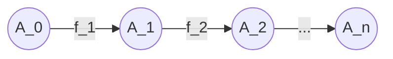

# Pipelines and Compatibility

> A pipeline externalizes composition as a directed path.

## 1. From equation to graph

For compatible functions

$$
f_i:A_{i-1}\to A_i,
\qquad i=1,\ldots,n,
$$

their composition is

$$
P=f_n\circ f_{n-1}\circ\cdots\circ f_1.
$$

The same structure can be drawn as a path:

The equation emphasizes denotation: what overall map is computed. The graph
emphasizes adjacency: which local stage feeds which neighbor.

## 2. A pipeline is ordered

Let

$$
\mathcal P=(V,E)
$$

be a directed path whose processing nodes are $v_1,\ldots,v_n$. Label each
node with a function

$$
\lambda(v_i)=f_i.
$$

The edge

$$
(v_i,v_{i+1})\in E
$$

asserts that the output of $f_i$ is offered to $f_{i+1}$. The path order is
therefore part of the computation, not merely a display choice.

## 3. Adapters live on boundaries

Suppose adjacent domains do not match directly:

$$
f_i:A_{i-1}\to A_i,
\qquad
f_{i+1}:B_i\to A_{i+1}.
$$

An adapter

$$
\alpha_i:A_i\to B_i
$$

makes the joint explicit. The local segment becomes

$$
A_{i-1}\xrightarrow{f_i}A_i
\xrightarrow{\alpha_i}B_i
\xrightarrow{f_{i+1}}A_{i+1}.
$$

For the full path,

$$
P=f_n\circ\alpha_{n-1}\circ f_{n-1}\circ\cdots\circ\alpha_1\circ f_1.
$$

This view discourages invisible coercion. A conversion that can lose data,
change units, or fail deserves a named place in the path.

## 4. Local contracts, global path

Every stage only needs to know its own boundary and the adjacent contract:

$$
\operatorname{cod}(f_i)\cong\operatorname{dom}(f_{i+1}).
$$

No stage must understand the full pipeline merely to participate. Yet the
global path is valid only if every local joint is valid.

This yields a useful invariant for **type-validity** of the path:

$$
\operatorname{typeValid}(\mathcal P)
\iff
\bigwedge_{i=1}^{n-1}
\operatorname{compatible}(f_i,f_{i+1}).
$$

Global type-composability emerges from repeated local compatibility. This is
necessary, but not sufficient, for semantic correctness: two stages may accept
the same data type while disagreeing about units, ordering, authorization, or
other meaning.

## 5. Linear shape, non-linear systems

A pipeline is a path. Real systems often contain:

- branches;
- joins;
- retries;
- feedback;
- shared dependencies;
- concurrent stages.

Those structures require richer directed graphs. We should not call every
graph a pipeline. Instead, the pipeline is the simplest graph on which the
ideas of local ports, compatibility, and composition become visible.

## 6. Errors are part of the path

If a stage may fail,

$$
f_i:A_{i-1}\to\operatorname{Result}(A_i,E_i),
$$

then ordinary function composition is insufficient unless the next operation
knows how to propagate or handle that result. The pipeline needs a composition
rule for the computational context.

This is why robust pipeline libraries distinguish between:

- transforming a successful value;
- chaining another fallible operation;
- recovering from an error;
- collecting diagnostics.

The graph alone gives topology. The edge contract gives meaning.

## 7. What a pipeline does not show

A path shows where values move next. It does not necessarily show the nested
call stack, before/after behavior, ownership, or recursive part/whole
structure. Those belong to the wrapper and composite views developed next.
