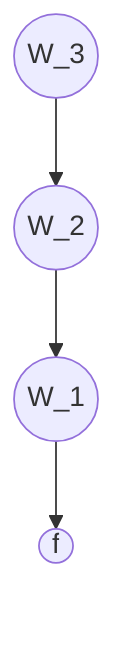
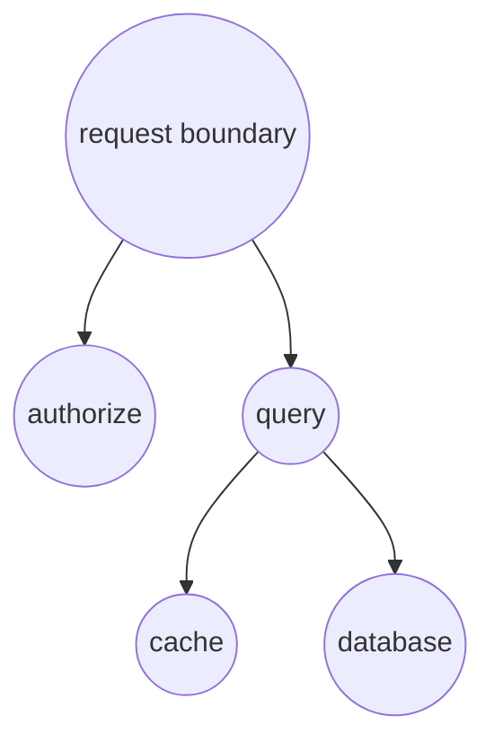

# Wrappers and Decorators

> A pipeline relates neighbors in sequence. A wrapper places one executable
> boundary around another.

## 1. Higher-order structure

Let

$$
f:A\to B.
$$

A wrapper constructor receives an operation and produces another operation:

$$
W:(A\to B)\to(A\to B).
$$

The resulting function

$$
W(f):A\to B
$$

preserves the same outer type while adding behavior around $f$.

A timing wrapper, for example, has the operational shape

```text
start timer
  call f
stop timer
return f's result
```

Its geometry includes both descent into the wrapped operation and return to the
outer boundary.

## 2. Nesting is not a pipeline path

Consider three wrappers:

$$
W_3(W_2(W_1(f))).
$$

Structurally, the wrappers are nested:



Execution travels inward and then outward:

$$
W_3\downarrow W_2\downarrow W_1\downarrow f
\uparrow W_1\uparrow W_2\uparrow W_3.
$$

A pipeline diagram usually emphasizes the forward movement of values. A
wrapper diagram must retain the return path because post-processing, cleanup,
measurement, and error translation often happen after the inner call returns.

## 3. Decorator pattern

The Decorator pattern gives the wrapper and wrapped component a common
interface $C$:

$$
f:C,
\qquad
D(f):C.
$$

Clients use the outer value through $C$ without needing to know whether it is a
leaf component or a stack of decorators.

Its essential conditions are:

1. component and decorator expose a common interface;
2. a decorator holds or delegates to another component;
3. the decorator adds behavior while preserving substitutability at that
   interface.

Calling another function is not, by itself, enough to establish this pattern.

## 4. Order changes behavior

Wrappers are generally not commutative:

$$
W_a(W_b(f))\neq W_b(W_a(f)).
$$

For example, retrying a timed request can mean either:

- time the entire retry operation;
- time each individual attempt.

The same two wrappers produce different observations depending on their order.
Nesting is therefore part of the semantics.

## 5. Transparent and observable wrappers

A wrapper may preserve the input/output type while still changing observable
behavior:

- latency;
- logs;
- caching;
- number of calls;
- errors;
- authorization;
- transaction boundaries.

Type compatibility does not imply semantic transparency. If callers rely on
these effects, they belong to the contract even when the function signature
stays unchanged.

## 6. Wrapper tree

A wrapper may coordinate more than one inner operation. The call relation then
forms a rooted tree, or a DAG if inner work is shared:



At this scale, one function can become a local orchestrator. If it directly
coordinates too many inner concerns, its local burden grows even though its
outer signature remains small.

## 7. Boundary design

Wrappers are useful when a concern belongs around an operation rather than
inside its core transformation. They are dangerous when nesting order is
implicit or when the shared interface hides effects that callers must know.

The architectural question is not “Can this be wrapped?” but:

$$
\text{Does this boundary preserve the behavior its consumers depend on?}
$$

