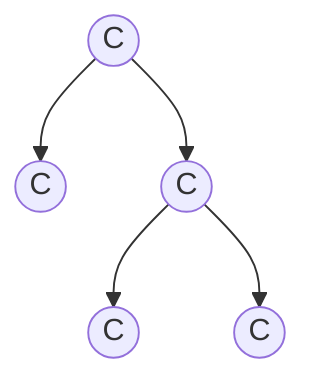

# Composites and Recursion

> A composite lets one component and a collection of components participate
> through the same boundary.

## 1. Recursive component family

Let $C$ be a component interface. A minimal recursive family is

$$
C ::= \operatorname{Leaf}(a)
\mid
\operatorname{Group}(C_1,\ldots,C_n).
$$

A leaf performs local work. A group contains children that are themselves
components. Both satisfy the same outer interface $C$.

This creates a part/whole structure:

The client may invoke the root without branching first on whether it is a leaf
or a container.

## 2. The Composite pattern

The software pattern requires more than “there is a tree.” Its defining idea
is uniform treatment through the shared component interface.

For an operation

$$
\operatorname{run}:C\to R,
$$

a leaf computes directly, while a group delegates recursively and combines
the child results:

$$
\operatorname{run}(\operatorname{Leaf}(a))
=\ell(a),
$$

$$
\operatorname{run}(\operatorname{Group}(C_1,\ldots,C_n))
=\gamma(\operatorname{run}(C_1),\ldots,\operatorname{run}(C_n)).
$$

The combining rule $\gamma$ is domain-specific. It may concatenate, sum,
render, validate, schedule, or aggregate.

## 3. A fold over the tree

The equations above define a fold. Given

- a leaf interpretation $\ell$;
- a combining operation $\gamma$;

the recursive structure can be reduced to a result:

$$
\operatorname{fold}_{\ell,\gamma}:C\to R.
$$

This separates shape from interpretation. The same tree can support multiple
operations by changing the fold:

- render the structure;
- count leaves;
- compute cost;
- validate constraints;
- serialize the tree.

## 4. Local knowledge

Each component only needs local rules:

- a leaf knows how to handle itself;
- a group knows its immediate children and how to combine their results.

No node needs a hard-coded description of the entire tree. The macroscopic
result emerges from recursive application of the same contract.

This is a software form of scale invariance: a subtree can be treated as one
component at the parent boundary even though it contains many components
inside.

## 5. Composite versus decorator

Both patterns preserve a shared interface, but their geometries differ.

Composite:

$$
\operatorname{Group}(C_1,\ldots,C_n):C
$$

Decorator:

$$
\operatorname{Decorate}(C):C.
$$

So:

- composite is primarily one-to-many containment;
- decorator is primarily one-around-one wrapping.

They can be combined. A decorator may wrap a composite, and a composite may
contain decorated children. The common interface makes this orthogonality
possible.

## 6. Trees, DAGs, and cycles

The recursive definition naturally produces a tree when every child has one
parent. Shared components produce a DAG. Back-references produce cycles.

Each extension changes the operational requirements:

- DAG traversal may need memoization to avoid repeated work;
- cyclic graphs need visited-state or a fixed-point interpretation;
- mutable sharing introduces aliasing and ownership concerns.

The common interface still helps, but it does not erase graph topology.

## 7. Architectural scale

A composite is already a small architecture. It has:

- component roles;
- dependency edges;
- recursive boundaries;
- local rules;
- a global behavior obtained through traversal.

The next question is how to translate one structured world into another while
preserving those relations. That is the role of the functor concept.
