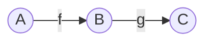
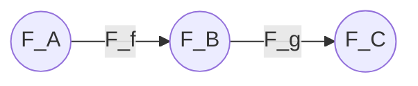

# Functors and Structure Preservation

> A functor does not merely map values. It maps a structured world into another
> while preserving identity and composition.

## 1. Categories as compositional worlds

For this Entry, a category $\mathcal C$ supplies:

- objects $A,B,C,\ldots$;
- morphisms $f:A\to B$;
- an identity morphism $\operatorname{id}_A$ for every object;
- an associative composition operation.

The laws are

$$
f\circ\operatorname{id}_A=f,
\qquad
\operatorname{id}_B\circ f=f,
$$

and

$$
h\circ(g\circ f)=(h\circ g)\circ f.
$$

A category deliberately ignores many internal details. It retains the objects,
the arrows, and the way arrows compose.

## 2. Functor definition

A functor

$$
F:\mathcal C\to\mathcal D
$$

maps every object $A$ in $\mathcal C$ to an object $F(A)$ in $\mathcal D$, and
every morphism

$$
f:A\to B
$$

to a morphism

$$
F(f):F(A)\to F(B).
$$

It must preserve identity:

$$
F(\operatorname{id}_A)=\operatorname{id}_{F(A)},
$$

and composition:

$$
F(g\circ f)=F(g)\circ F(f).
$$

These are not decorative equations. They guarantee that a valid path before
the mapping remains the corresponding valid path after the mapping.

## 3. Diagram preservation

Start with

After applying $F$:

The composed route is preserved:

$$
A\xrightarrow{g\circ f}C
$$

becomes

$$
F(A)\xrightarrow{F(g\circ f)}F(C)
=
F(A)\xrightarrow{F(f)}F(B)\xrightarrow{F(g)}F(C).
$$

The representation changes; the compositional relation does not.

## 4. A programming example: mapping a container

Consider the category whose objects are value types and whose morphisms are
pure functions between them. `List` acts as an endofunctor on this category:
it maps each type $A$ to $\operatorname{List}(A)$ while `map` lifts each pure
function to the corresponding function between list types.

For a list-like container, define

$$
\operatorname{map}(f):\operatorname{List}(A)\to\operatorname{List}(B).
$$

The functor laws become

$$
\operatorname{map}(\operatorname{id})
=
\operatorname{id},
$$

and

$$
\operatorname{map}(g\circ f)
=
\operatorname{map}(g)\circ\operatorname{map}(f).
$$

The first says mapping the identity leaves the container unchanged. The second
says mapping a composed transformation is equivalent to mapping the stages in
sequence.

This example earns the name “functor” because the object mapping, morphism
mapping, and both preservation laws are present. Tests can provide evidence for
the laws over chosen examples, while a general proof depends on the definition
of `map`. A generic object named `Mapper` does not become a functor by naming
alone.

## 5. Architecture translation

Suppose one model describes a logical graph and another describes executable
components. A structure-preserving translation can map

$$
\text{logical node}\mapsto\text{runtime component}
$$

and

$$
\text{logical edge}\mapsto\text{runtime connector}.
$$

Calling this map a functor is justified only if:

1. identity relations remain identities;
2. composing logical edges and then translating agrees with translating each
   edge and composing the resulting connectors.

Without those laws, “functor-like” is at most an intuition.

## 6. What functors are not

A functor is not automatically:

- a pipeline;
- a wrapper;
- a decorator;
- a composite;
- any function that converts one value into another.

Those structures may participate in categorical models, but the word functor
refers specifically to a law-preserving map between categories.

## 7. Why the abstraction matters

Structure preservation lets us change representation without losing the paths
that give a system meaning. This appears when translating:

- syntax trees into evaluators;
- schemas into validators;
- logical plans into executable plans;
- domain graphs into storage graphs;
- abstract components into deployed services.

The implementation may differ radically from the model. The functor laws ask
whether composition survives that translation.
