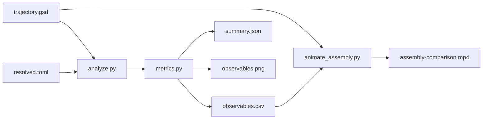

# 3. From trajectory to measurements and video

HOOMD writes microscopic states. Research decides how to observe them.

## Data flow



## Reading one trajectory

[`analyze()`](../../analyze.py) iterates through every saved GSD frame. For each
frame it obtains:

- the exact timestep and simulated time;
- thermodynamic quantities logged by HOOMD; and
- structural quantities computed by [`structural_observables()`](../../metrics.py).

The structural analyzer receives arrays of positions, orientations, type IDs,
and the resolved configuration. It does not mutate the trajectory.

## Building the contact graph

[`contact_edges()`](../../metrics.py) checks candidate pairs in the saved frame.
For an isotropic run, distance below the analysis cutoff creates an edge. For a
patchy run, both particles must also have a director whose dot product with the
appropriate center direction is at least `0.95`.

This analyzer currently uses an explicit pair loop. That is readable and fine
for $N\le192$. It is separate from HOOMD's optimized cell neighbor list. A
larger analysis would need its own spatial index to avoid $O(N^2)$ pair checks.

## Connected components

[`component_sizes()`](../../metrics.py) uses a union-find data structure:

1. every vertex begins as its own parent;
2. each contact edge unites two sets;
3. path compression makes repeated root lookup cheap; and
4. the final root counts are component sizes.

The largest size divided by $N$ becomes `largest_component_fraction`.

## Angular order

[`bond_orientational_order()`](../../metrics.py) converts contact directions to
complex phases $e^{6i\theta}$. It returns two values:

- the mean of local magnitudes; and
- the magnitude of the global complex mean.

Keeping these separate is why the experiment can distinguish individually
ordered domains from one sample-wide orientation.

## Time series and summary

Every sampled frame becomes one row in `observables.csv`. This file is the best
place to learn how the macroscopic variables evolve rather than only looking at
the end.

`summary.json` records final values, maxima, the time of the largest component,
first-passage times, and the change measured across field activation.

The saved PNG shows four basic views:

1. potential and kinetic energy;
2. kinetic temperature;
3. largest connected fraction; and
4. structural order metrics.

## How the comparison video is built

[`animate_assembly.py`](../../animate_assembly.py) loads the three 96-particle
trajectories:

- isotropic;
- three-patch; and
- three-patch with delayed field.

All panels use the same simulation frame index, so they share simulated time.
The renderer draws particles, visible patch directors, inferred contact edges,
and three live metrics. At $t=180$ it displays the field marker on the third
panel.

The animation does not influence or interpolate the physics. It samples saved
frames, briefly holds important moments, and encodes them as H.264 video.

## Current output layout

```text
outputs/assembly/
├── isotropic/seed-0041/
│   ├── resolved.toml
│   ├── trajectory.gsd
│   ├── observables.csv
│   ├── observables.png
│   └── summary.json
├── three-patch/seed-0041/
├── three-patch--delayed-field/seed-0041/
├── three-patch--small/seed-0041/
├── three-patch--large/seed-0041/
├── assembly-study.json
└── assembly-comparison.mp4
```

These outputs are intentionally ignored by Git. The source configuration and
analysis are versioned; expensive trajectories can be regenerated.

## Use the notebook

Open [`assembly-lab.ipynb`](assembly-lab.ipynb) from this project environment:

```bash
pixi run jupyter lab docs/practical/assembly-lab.ipynb
```

The notebook reads the existing CSV and JSON files. It does not rerun HOOMD.
Use it to inspect the result table, compare time series, and test alternative
questions before changing the simulation itself.

## Reproduction order

On a new machine:

```bash
pixi run test
pixi run assembly-smoke
pixi run assembly-study
pixi run assembly-video
```

Run the full study only after the smoke test completes.

